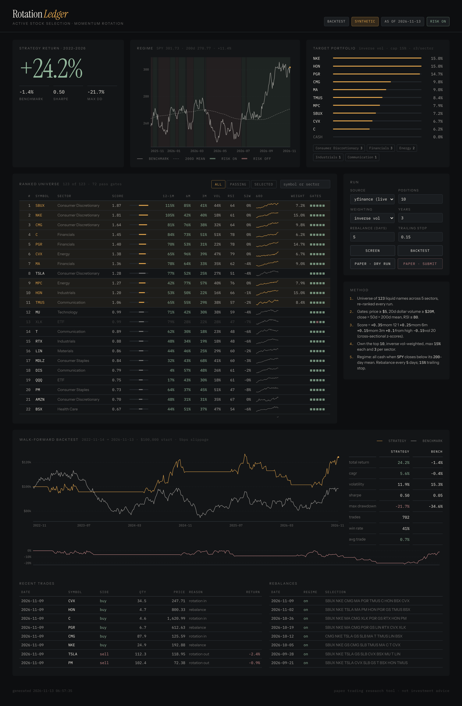

# Algorithmic trading lab (Python)

A standalone Python companion to Stockbot. It is where the momentum-rotation
idea was prototyped before being built into Stockbot's **Rotation** page
([docs/ROTATION.md](../docs/ROTATION.md)). Use it for quick research in
pandas; use Stockbot for reproducible backtests, paper sessions and the
audited ledger.

| | This folder (Python) | Stockbot (Node + React) |
|---|---|---|
| Rotation screen and backtest | `python run.py screen` / `backtest` | Rotation page, `npm run rotation` |
| Data | yfinance, or a seeded synthetic market offline | Alpaca / Polygon / Finnhub real bars only |
| Paper orders | Alpaca paper account via `alpaca-py` | Stockbot's in-process paper broker |
| UI | `python run.py dashboard` on port 8765 | `npm run dev` on port 5173 |

Both rank with the same rules: gates before scoring, the same momentum
score, top ten with at most three per sector, inverse-volatility weights
capped at 15%, and cash when SPY is below its 200-day mean. Their backtests
execute differently. This one fills at the decision day's close; Stockbot
fills at the next day's open, which is stricter, so expect its numbers to be
somewhat lower. They are separate code; when the rules change, Stockbot's
version is the one that is maintained.

All commands below run **from this folder**:

```bash
cd algorithmic-trading
python -m venv .venv && source .venv/bin/activate
```



## Quick start

```bash
pip install -r requirements.txt
python run.py screen                  # rank the universe with live Yahoo data
python run.py backtest --years 3      # walk-forward backtest, weekly rotation
python run.py dashboard               # http://127.0.0.1:8765
```

No internet?  Add `--source synthetic` to any command to run on a seeded,
simulated market (the dashboard flags it in amber).  `--source cache` reuses
the last download.

```bash
python -m pytest tests -q             # offline test-suite
```

## How the algorithm chooses tickers

| step | what happens | where |
|---|---|---|
| universe | ~120 large caps across 11 sectors + broad ETFs; `python run.py universe-sp500` swaps in the full S&P 500 | `trader/universe.py` |
| signals | 12-1 / 6 / 3 / 1-month momentum, 20d volatility, 50/200-day trend, distance from 52-week high, RSI-14, dollar volume, relative strength vs SPY | `trader/signals.py` |
| gates | price ≥ $5, 20d dollar volume ≥ $20M, close > 50d > 200d mean, RSI ≤ 80 | `trader/screener.py` |
| score | weighted cross-sectional z-scores: `+0.35·mom12-1 +0.25·mom6m +0.15·mom3m +0.10·from-high −0.15·vol` | `trader/signals.py` |
| selection | top 10 by score, at most 3 per sector | `trader/screener.py` |
| sizing | inverse-volatility weights, 15% cap; **all cash when SPY is below its 200-day mean** | `trader/allocator.py` |
| execution | weekly rebalance, 2% no-trade band, 15% trailing stop | `trader/backtest.py`, `trader/broker_alpaca.py` |

All signals are point-in-time: the backtest re-runs the screener on each
rebalance date using only data up to that day.

## Paper trading on Alpaca

Export your paper keys in the shell (never write them into a file in this
public repository), then:

```bash
export APCA_API_KEY_ID=...
export APCA_API_SECRET_KEY=...
```

```bash
python run.py paper                   # dry run: shows the orders it would send
python run.py paper --live-orders     # submits them to the PAPER account
```

The dashboard's **paper · dry run** / **paper · submit** buttons do the same.
`lumibot_rotation.py` is an optional Lumibot adapter that reuses the same
screener (needs `pip install lumibot`).

## Dashboard

`python run.py dashboard` serves a dependency-free UI on port 8765 that reads
`output/state.json` and can trigger screens, backtests and paper rebalances.
Its visual system is described in [`design/PHILOSOPHY.md`](design/PHILOSOPHY.md).

## Layout

```
run.py                  CLI: screen | backtest | paper | dashboard | universe-sp500
trader/                 engine (universe, data, signals, screener, allocator, backtest, broker, state)
dashboard/              stdlib HTTP server + static UI
tests/                  pytest suite (synthetic data, no network)
design/                 design philosophy + rendered UI
lumibot_*.py, *.py      original single-ticker course demos
```

This is a research tool for paper trading, not investment advice.

## Where this came from

Imported from [Dankcode/algorithmic-trading](https://github.com/Dankcode/algorithmic-trading),
a fork of [mjmacarty/algorithmic-trading](https://github.com/mjmacarty/algorithmic-trading).
The single-ticker demo scripts (`strategy.py`, `portfolio.py`,
`single_stock.py`, `alpaca_demo.py`, `gld_signal.py`, `ts_demo.py`,
`lumibot_buy_hold.py`, `lumibot_swing_high.py`, `lumibot_trend.py`) are
Matt Macarty's course examples; the upstream repository has no license file.
`trader/`, `run.py`, `dashboard/`, `tests/`, `design/` and
`lumibot_rotation.py` were added on top.

Files were copied without their git history, because earlier upstream
commits contain credentials that should not be republished here. The
upstream author's 2023 run logs were also left out.
