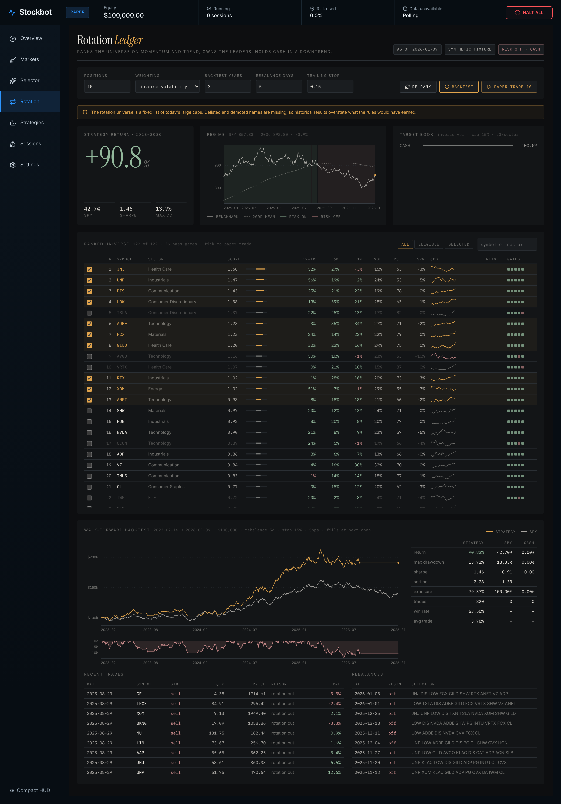

# Momentum rotation

The **Rotation** page (sidebar → Rotation, `/rotation`) is Stockbot's active stock-selection strategy. Instead of testing one hand-picked symbol, it ranks a whole universe on every run, owns the leaders, and moves to cash when the market is in a downtrend.



*The screenshot uses a seeded synthetic market, labelled `SYNTHETIC FIXTURE` in the header, because the machine that rendered it had no provider credentials. The product itself only ranks real provider bars.*

## How it differs from the Selector

| | Selector (Board B) | Rotation |
|---|---|---|
| Question | Which symbols are good *experiment subjects*? | Which symbols does this strategy *own* right now? |
| Ranks on | Liquidity, volatility band, trend clarity, research coverage | 12-1, 6 and 3-month momentum, 52-week high, volatility |
| Output | A shortlist to measure | Target weights, a regime call, and a walk-forward backtest |
| Predicts returns? | No, by design | It is a return hypothesis, tested against SPY and Cash |

## The rules

1. **Universe.** About 120 liquid US large caps across eleven sectors plus ten broad and sector ETFs (`server/selection/rotation-universe.js`). SPY is the regime gauge and benchmark, never a holding.
2. **Gates, before scoring.** A full 253-day history, price at least $5, 20-day average dollar volume at least $20M, close above the 50-day mean above the 200-day mean, and RSI(14) at most 80. A failed gate excludes the symbol with a stated blocker; it is never scored down.
3. **Score.** Cross-sectional z-scores, clipped at ±3:
   `+0.35 · 12-1 month momentum  +0.25 · 6-month  +0.15 · 3-month  +0.10 · distance from 52-week high  −0.15 · 20-day volatility`
4. **Selection.** The top 10 by score, at most three per sector.
5. **Sizing.** Inverse-volatility weights, at most 15% each. Equal weighting is available.
6. **Regime.** When SPY closes below its 200-day mean, the target book is 100% cash. If SPY bars are missing, nothing is ranked: an unmeasured regime is not treated as risk-on.

All factors are point-in-time. The same pure functions (`server/selection/rotation.js`) serve the live screen and every rebalance in the backtest.

## Walk-forward backtest

**Backtest** on the page (or `GET /api/v1/rotation/backtest`) replays the rules over up to seven years of daily bars:

```text
bar N closes → rank on data through N → orders pending → bar N+1 opens → fill
```

- Fills use the next bar's real open through the shared fill model (5 bps slippage by default).
- A rebalance decided on the final bar is reported as unfilled, never filled at an invented price.
- Weekly rebalancing by default, a 2% no-trade band, and a 15% trailing stop from the highest close. A stopped-out name sits out until the next rebalance.
- Results are shown beside **SPY buy-and-hold** and **Cash**, with the same metrics as every other Stockbot backtest.

> [!WARNING]
> **Survivorship bias.** The universe is a fixed list of today's large caps, so every name on it survived. Delisted and demoted companies are missing, and historical results overstate what the rules would have earned. Every screen and backtest response carries this warning. Treat a backtest as an upper bound and judge the strategy in forward paper trading.

## Paper trading the picks

Tick symbols in the ranked table (the current selection is pre-ticked) and press **Paper trade**. Stockbot opens the new-session dialog with those symbols and the bundled **Rotation Momentum** strategy (`algorithms/rotation-momentum.js`) preselected.

That strategy applies the same entry rule per symbol: close above the 50-day mean above the 200-day mean, positive 12-1 momentum, and RSI at most 80. It exits on a close below the 50-day mean or a 15% trailing stop from the highest close. Sessions run on Stockbot's paper broker; no live brokerage order route exists.

## API

| Route | Query | Returns |
|---|---|---|
| `GET /api/v1/rotation` | `top` 1–40, `weighting` `inverse_vol`/`equal`, `maxPerSector`, `maxWeight`, `trend` | Ranked rows with factors, blockers, sparklines, regime series, target weights |
| `GET /api/v1/rotation/backtest` | the above plus `years` 1–7, `rebalance` 1–63, `stop` 0–0.9 | Equity, SPY and drawdown curves, metrics for strategy/SPY/Cash, trades, rebalances |

Both are read-only and need no mutation token. Without provider credentials they return `available: false` with the reason and the per-symbol fetch errors.

## Command line

```bash
npm run rotation -- screen --top 10
npm run rotation -- backtest --years 3 --rebalance 5 --stop 0.15
```

See the [CLI reference](./CLI.md#rotation).
